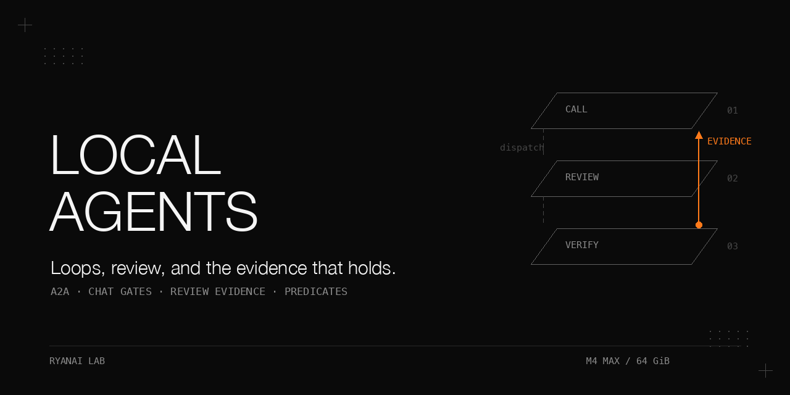

# Local multi-agent coordination

Loops, self-review and config-reading traps when several agents share one machine.

When agents call, review or message each other, the dangerous failures are often ordinary defaults: a worker grades itself, a child reads a different configuration file, or a guard returns an empty answer that looks like “not configured.” This book follows the mechanisms that exposed those failures: atomic ledger admission, a wall-clock backstop, evidence written by the dispatcher, acceptance in the worker's own environment, and a synchronous predicate pass. The hub eventually passed **16 of 16** call-matrix cells. On one machine with one orchestrator, it still was not worth keeping resident.

## Why this matters

A successful request proves very little about a coordination system. The reply can hide a crashed child, a review can be self-review, and a test can pass because its own environment activates an exemption. Each chapter pairs a failure with the observation that discriminates it from a healthy system.

The historical measurements below come from one supplied experiment record. The public code uses synthetic fixtures and explicitly named mocks. Passing those tests does not repeat the original live-agent experiments. Full tables are in [results](docs/results.md); detailed symptom-to-fix chains are in [pitfalls](docs/pitfalls.md).

The controls have different jobs. The hub refuses work before starting a session. The chat net filters individual messages and fails open. The completion tool steers a worker toward review. The dispatcher records missing evidence without changing a card. The predicate pass decides from artifacts, not from a worker's reply.

## What is in this book

| Chapter | What it establishes |
|---|---|
| [Four CLI agents behind an A2A adapter](docs/hub.md) | Protocol provenance, process lifecycle, a call matrix, and the non-transport faults behind apparent transport failures. |
| [Loop bounds that hold](docs/loop-bounds.md) | Atomic admission, depth and repeat limits, the wall-clock breaker, and its corrected counting bug. |
| [Stopping a hub](docs/stopping-services.md) | A clean-exit stop file, a hidden second install, and the evidence for stopping the resident services. |
| [Chat loops between bots](docs/chat-loops.md) | A measured slow loop, an auditable gate net, and why suppressing individual replies did not end the exchange. |
| [Self-review on a task board](docs/review-gate.md) | A mechanical reviewer map, completion exemptions, adversarial findings, and a narrower claim. |
| [The config-reading trap](docs/config-trap.md) | Root policy read through a profile loader silently becomes an exemption. |
| [Evidence outside the worker's tool](docs/dispatcher-evidence.md) | A detect-only dispatcher scan with strict run evidence, watermarks and positive controls. |
| [A single-writer predicate pass](docs/predicate-pass.md) | Deterministic acceptance, bounded retries, an executor contract and exception cleanup. |

## The setting

All original work ran on a **single Apple-silicon Mac: M4 Max, 64 GiB**, under macOS with launchd. The CLI agents used remote models; nothing here depends on local inference, and no GPU is needed. Agents A and B were coding agents from different vendors; C and D were personal-agent runtimes with CLIs. One runtime supplied the task board.

| Component | Recorded version or form | Condition |
|---|---|---|
| Hub Python | 3.13.x; 3.13.13 in the 2026-10-03 re-run | Project requires >= 3.13; package manager `uv`. |
| `a2a-sdk` | 1.1.2 | Protobuf types, snake_case fields; Apache-2.0. |
| `mcp` | 2.0.0 in the re-run; registry written against 2.x | `MCPServer`, SSE transport. |
| Reference sample | `a2aproject/a2a-samples`, `samples/python/agents/a2a_mcp` | Its lock pinned the withdrawn `a2a-sdk` 0.3.0 wheel; fetch returned 404. |
| Agent A | a terminal coding agent, 2.1.158 at the August 2026 handshake probe | Non-interactive `-p`. |
| Agent B | a second coding agent from another vendor, around 0.144 in August 2026 | Non-interactive `exec`. |
| Task board | SQLite board and 60-second dispatcher tick, release tag 2026.8.31, local patches | MIT upstream; runtime intentionally unnamed. |
| Board storage | `journal_mode=DELETE`; embedded SQLite 3.50.4 | The original hit the WAL-reset corruption bug; relevant to timing, not gate logic. |
| Chat | A Discord-style server with bot accounts | Numeric mention syntax; only synthetic identifiers ship here. |

## Chapter 1: Four local CLI agents behind an official A2A adapter

**Problem.** Each agent should call another, call back, form a chain, or fan out. A home-made dispatcher would duplicate existing protocols; putting chain state in a prompt would ask a model to report its own position reliably.

**Mechanism.** The official SDK carries `context_id`, `task_id` and `reference_task_ids`. The adapter exports inherited context and references to its child; the call helper merges explicit references rather than replacing inherited ones. References are a JSON list, so a separator inside an identifier cannot create extra ancestors. Caller identity comes from the ledger entry for the last reference, not the receiving process's environment.

A command template is split once, then `{prompt}` and `{session}` are substituted as whole argv elements. `create_subprocess_exec` does not reparse them through a shell. The adapter uses `/dev/null` stdin, merged stderr/stdout, its own child process group, a semaphore, and error-preserving output filtering. CLI failures return agent text; transport failures remain distinguishable.

Servers bind to loopback and require a bearer token; the card endpoint is public. The token is created atomically with mode 0600 and rejected on unsafe ownership, permissions or symlink state. The recorded registry had no bearer. Loopback by itself was not authentication.

**Procedure as run.** Reflect the installed SDK; bring up agent B, then D; verify a D-to-B-to-D chain; add the other adapters with honest blocked status; run the matrix by caller row; have agent B review code through the hub itself. Each matrix cell required a verbatim token through a two-hop round trip. Self-call cells were deliberate deadlock checks.

Conditions: 2026-08-02, one machine, one run per matrix cell. Fan-out and chain observations were from the same week.

| Observation | Result | Qualification |
|---|---|---|
| First adapter pass | 2 of 4 agents verified | Other agents recorded as blocked; their diagnoses were later corrected. |
| Corrected call matrix | 16 of 16 | Includes 4 self-call cells; two real hops per cell. |
| Concurrent fan-out | 14.3 s | Sum of single calls was more than 40 s. |
| Per-target deadline of 6 s | 2 of 4 answered; 2 of 4 timed out | Call returned and named missing agents. |
| Authentication | no token: 401; public card: 200 | With token, the full chain worked. |

**What did not work.** `_meta` was null in all three captured handshake frames, with `protocolVersion: 2025-11-25`; agent B marked the probe unsupported. A newer client changelog, 2.1.220, showed no protocol upgrade. The official sample could not run end to end without an unavailable hosted-model API key. Its withdrawn wheel also required removing the lock and upgrading to 1.1.2.

A concurrency cap of 2 could starve a self-call; it was raised to 6. Separator-bearing tokens were shortened by models. About 30 concurrent sessions caused congestion when all 16 cells ran at once. An uninitialised identity caused about 1 call in 3 to onboard instead of work; four consecutive runs were stable after the identity fix. These were not transport defects.

**Rule.** Put provenance in adapter-filled protocol fields, and require the token to return through the full path. Re-diagnose blocked agents from the effective environment and ground-truth logs. [Full mechanism, review rounds and CLI traps](docs/hub.md).

## Chapter 2: Loop bounds that hold

**Problem.** A hop starts a full CLI session. A cycle can keep spending and changing state even when each individual call appears valid.

**Mechanism.** `admit()` holds one exclusive `flock` across reading the ledger, deciding, and appending the hop. It rechecks the lock inode, retrying up to 5 times; an unstable lock refuses admission. A torn JSON line is skipped. Outcomes append separate rows. A refusal marker prevents an aggregator from counting “declined” as an answer.

The child starts in a separate process group. Timeout or cancellation kills and reaps the group; killing only the direct child left a grandchild running. The fleet-wide breaker ignores both prompt content and agent identity. The other bounds remain useful but are individually evadable.

Conditions: named defaults were chosen by reasoning, not by measured false-refusal rates.

| Bound | Default | Decision |
|---|---|---|
| Depth | `MAX_DEPTH = 6` | Refuse when the incoming chain already has 6 references. |
| Repeat | `MAX_REPEAT = 2` | Refuse the same agent's third identical ask in one context; fingerprint is first 16 hex of whitespace-normalised sha256. |
| Per-agent breaker | `BREAKER_MAX = 12` | Refuse further sessions in `BREAKER_WINDOW_S = 300`. |
| Fleet breaker | `BREAKER_FLEET_MAX = 30` | Refuse further sessions in the same 300 s window, regardless of name or context. |

**Procedure as run.** Construct a cycle and a legal callback; review through agent B; reproduce every claimed bypass before fixing it; then test name rotation and lock replacement. The review found 3 BLOCKER and 4 MAJOR issues initially, followed by 2 targeted attacks. The original chain suite passed 17 of 17 on 2026-10-03 with Python 3.13.13 and SDK 1.1.2; denoise checks also passed.

Conditions: scratch-ledger reproduction during book preparation; rotating names and distinct questions, with or without an outcome after each hop.

| Counter implementation | Admitted before refusal | Condition |
|---|---|---|
| Original, outcomes written | 15 | The original tripped at 15: outcome rows counted as sessions. |
| Original, no outcomes | 30 | One ledger row per admitted hop. |
| Shipped correction | 30-hop limit | Count `kind == "hop"`; missing `kind` remains a legacy hop. This is a corrected implementation, not a historical live measurement. |

**What did not work.** A counter suffix defeated prompt fingerprints; clearing inherited environment reset chain depth; name rotation multiplied a per-agent quota. Separate check and record admitted 10 of 10 concurrent identical hops. The fix was a single critical section, not a stronger prompt.

The full matrix needs 32 hop rows, or 64 rows including outcomes, against the 30-per-300 s default. The breaker landed after the matrix; no later full matrix re-run is recorded. The public mock raises the cap only for its isolated matrix ledger. Boundary tests retain the named defaults and include both 20 completed hops and the full 30-hop limit.

**Rule.** Count sessions, not bookkeeping rows; test the observed boundary. Keep callback and just-below-boundary controls so a guard that refuses everything cannot pass. [All bypasses and ledger observations](docs/loop-bounds.md).

## Chapter 3: Stopping a hub, and whether to run one

**Problem.** Working interoperability still has an operating cost. User-level service removal did not reliably stop the hub.

**Mechanism.** The server and registry check a stop file before heavy imports, print one line and exit 0. With launchd `KeepAlive = { SuccessfulExit = false }` and a 10 s throttle, that clean exit does not restart. Deleting the stop file and kickstarting or logging in restores the service.

**Procedure as run.** Collect usage evidence; disable and unload the user services; investigate three reappearances; discover a system-level second install. Administrator access was deliberately not obtained. The stop file stopped both entry points without requiring it; clean removal instructions were left for later.

Conditions: decision record for 2026-08-02 to 2026-08-16; separate read-only checks on 2026-10-03.

| Observation | Value | Evidence boundary |
|---|---|---|
| Real use in 14 days | 2 calls, both to B | Owner's account; both had a shorter direct route. |
| Ledger | 26 hop rows | Mixed real and test traffic; not a real-use counter. |
| Resident service cost | 4 adapters plus registry; 5 services | Ports also reserved. |
| Stopped state | Stop file created 2026-08-16, present 2026-10-03 | File presence checked; ports not probed. |

**What did not work.** Removing only user-level services missed the system copy. Renaming the entry file would have created a KeepAlive crash loop. The old installer also hand-listed only two agents despite four verified adapters.

The replacement was shell dispatch with packet files and no resident worker. A per-context workspace directory was proposed but never built. No container isolation, extra memory database, DAG engine, inbound screener or multi-tenant machinery was built for this single-user setting. A second machine with a worker was the recorded condition for revisiting the hub.

**Rule.** Price the resident layer against the ownership boundary and actual use. Preserve a reversible, clean-exit stop mechanism. The public [plist generator](scripts/generate_services.py) reads the registry and only prints definitions. [Full stopping record](docs/stopping-services.md).

## Chapter 4: Chat loops between bots

**Problem.** The measured failure was a slow exchange of short sentences after a scheduled report. A burst limiter designed for rapid acknowledgement ping-pong did not match that shape.

**Mechanism.** The early bridge had input filtering, a per-sender/channel limit of 3 triggers in 60 s with a 300 s mute, bot-aware prompt etiquette, and low-content output filtering. The later net orders outbound gates as secrets, silence window, placeholder silence, mention rewrite, cooldown. Bot-authored `[ACK]` opens an 8 s channel window; human commands beginning with `[ACK]` do not.

Placeholder inspection stops above 30 characters. Re-mention suppression uses a 60 s window per sender/target. State persists atomically and expired entries are pruned on load. Every suppression or rewrite records a timestamp, gate, channel, length and first 12 hex of sha256, never raw content. Startup reports an empty registry or disabled net loudly. Internal errors intentionally allow the original text.

**Procedure as run.** Count mention-bearing inbound messages by session over a 30-day window; normalise timestamps and whitespace; read the gate audit on 2026-10-03; reconstruct the large event from timestamps. The historical tests included 24 gate checks, 6 bridge integration checks and five gateway test files; the public replacements do not import the runtime.

Conditions: September 2026 baseline. Audit rows for the event were selected between 01:30 and 04:00 on 2026-09-04 in one channel.

| Observation | Value | Qualification |
|---|---|---|
| Event A | 2026-09-04 02:00 to 03:14; 74 min; 90 messages | Max normalised sentence repeats 11; working notes counted 31 distinct contents. |
| Event B | 2026-08-07; 7 messages | Max repeats 1. |
| Window total | 97 messages over 30 days | The notes' “97 in 74 minutes” conflated the window with event A. |
| Event A gate activity | 64 rows | 24 cooldown suppressions, 8 empty-reply suppressions, 32 rewrites. |

**What did not work.** The cooldown fired during the loop, so “the net was inert” is withdrawn. Why the exchange continued is an inference: individual suppressions did not latch, and about 1.2 messages/minute overall, about 0.6 per sender, is unlike a burst. There was no controlled replay and no measured normal-traffic rate, so no replacement threshold is recommended.

Five real tasks in bot-messaging mode had max 2 messages per task, max repeat 1, pick-up 5 of 5 and median 31.4 s; 2 of 5 deliveries were fabricated after a weak-model fallback. This is background motivation, not a controlled chat-versus-board result. The historic board baseline was 4 of 9 (44%) and had no new cards for three months.

Streaming must evaluate the stateful gate exactly once at finalize. Evaluating twice records a mention and then suppresses the same message. A swallowed import error once made suppression tests pass with no working gate. A newer native-streaming branch remains ungated.

**Rule.** Measure cadence and content variety; a latching bound is the recorded direction, not a shipped or calibrated fix. Prove the gate fires, preserve its state, and test an actual suppressed delivery. [Complete audit table and inference limits](docs/chat-loops.md).

## Chapter 5: Self-review is the default on a task board

**Problem.** Review dispatch uses the current assignee. An optional reviewer argument therefore lets a worker request review from itself by omission.

**Mechanism.** Resolve an empty reviewer through a root configuration map before dispatch. The map follows model families; a profile must not review itself. Unknown or self-mapped entries return `None`, preserving upstream behaviour. A completion-tool check runs before the database write, because a worker can otherwise skip review entirely.

There was no suitable lifecycle hook: no review-requested hook or pre-complete hook; completed fires after commit. Reassigning from an external watchdog would race the 60-second dispatcher tick.

Conditions: one board, 2026-09-06 through 2026-09-08.

| Control | Sample | Result |
|---|---|---|
| Default smoke test, 2026-09-06 | 3 cards, two itemised | Implementer self-reviewed. |
| Prompt control, 2026-09-06 | card 1 and card 2 | Named reviewer used. |
| Equally clear prompt, 2026-09-08 | card 3 | `reviewer = None`; self-review. |
| Prompt compliance | 2 of 3 | Prompt text was not a bound. |

**Procedure as run.** Add the prompt convention, measure who reviewed, implement the map, then test cards whose bodies omit review instructions. Add the completion gate and a pre-created-child control. An explicit-reviewer end-to-end run took 228 s for execution and 79 s for review, with 41 reviewer tool calls; the reviewer re-ran probes and found a nit.

The gate's short-circuit exemptions are part of its specification:

| Exemption | Allowed path |
|---|---|
| E1 | Master switch false. |
| Retry | Card already done or archived. |
| E2 | No default reviewer resolves. |
| E3 | Latest review-request event is not an explicit normalised self-handover; malformed evidence is lenient here. |
| E4 | A child existed before the card's first run. |
| E5 | This call lacks worker context. |

**What did not work.** Review found 12 upheld findings, 0 false positives: 6 fixed, 3 not fixed, 3 recorded as limits. The reconciliation table differs from a decision narrative that itemised 11 and named five fixes. After fixes, 9 of 9 temporary-database cases passed. Those original test files are no longer available; the public suite rebuilds the cases.

The gate cannot stop command-line completion, direct database writes, or a worker marking a card blocked. A review event is also a permanent history exemption, not proof that the current artifact version was reviewed. The original “cannot bypass” claim was withdrawn.

**Rule.** Resolve the default mechanically, test every exemption, and state the bypass surface beside the claim. Reconcile the map, its documented copy and profile existence whenever model assignments change. [Full gate findings](docs/review-gate.md); [shorter field guide](https://github.com/ryangu00/agent-guards-that-fail-silently).

## Chapter 6: The config-reading trap

**Problem.** The new reviewer map and completion gate both failed in worker processes on **2026-09-08**, the same day they shipped and the trap was found.

**Mechanism.** The dispatcher starts a child with its application home set to `<root>/profiles/<name>`. The generic loader reads that profile's file. Root policy is absent there, so the lookup returns `None`; E2 reads that as “no reviewer configured” and allows completion.

Resolve the fleet root with the runtime helper, read the root file with the raw reader, and use the generic loader as fallback if the root cannot be read. Both the reviewer table and the master switch need the root-aware reader. The lookup was later shared by the tool gate and dispatcher; their verdict criteria stayed separate.

**Procedure as run.** A card without reviewer instructions completed in one run with zero review events. Compare the lookup in the default home and a worker home, fix the reader, check four profile homes, then check agreement in three homes after moving the shared lookup. An earlier apparent success had explicitly named its reviewer in the body and had exercised the prompt path.

Conditions: same-day investigation on 2026-09-08; before-values not measured elsewhere remain unmeasured.

| Environment | Before | After |
|---|---|---|
| Worker profile A | `None` | Root-table reviewer. |
| Default home | Reviewer | Reviewer. |
| Worker profiles B and C | Not measured | Root-table reviewer. |
| Reviewer's own profile | Not measured | Implementer from another family. |

**What did not work.** Default-home unit tests hid the profile-relative loader. A card with reviewer instructions hid the failed map. Treating an unreadable policy file exactly like an intentionally absent policy remains a fail-open risk.

The supplied stdlib toy, verified in the source record on 2026-10-03, prints default-home block/block and profile-home allow/block. Fresh worker processes load the patched module without a gateway restart; long-lived gateway calls pick it up at their next restart.

**Rule.** Run a gate in the worker's actual home environment with its exemptions disarmed. Make absent policy distinguishable from unreadable policy when a root file is required. [Toy and full environment table](docs/config-trap.md); [related configuration case](https://github.com/ryangu00/agent-guards-that-fail-silently).

## Chapter 7: Evidence in a loop the worker cannot call

**Problem.** A tool-layer reminder cannot witness every completion path. The dispatcher can leave evidence when a worker completes through the terminal instead.

**Mechanism.** At tick step zero, under the board's single-writer lock, scan exact `completed` events above a per-board watermark. The first run only establishes the baseline. A global watermark JSON file is locked across read/modify/write. If its lock fails, write best effort with a warning; otherwise the first-run branch can remain permanently blind. Turning the master switch off leaves the watermark unchanged so re-enabling catches up.

A flag requires a done card, a non-zero-duration run, a reviewer for the first such run's profile, no other profile with a non-zero-duration run, and no genuinely pre-created child. The child's own `created` event must name the parent. Current assignee and zero-length synthetic runs do not prove who did the work.

**Procedure as run.** Correct a specification after the implementer challenged three assumptions; repair five defects in an outsourced draft whose green self-check was only a path walk-through; deploy with backups; review through two lanes; run deliberate bypass and negative controls. Observation appends one event and one WARNING; it does not reopen, dispatch or message.

Conditions: first-day live acceptance on 2026-09-09, all measured.

| Acceptance criterion | Result and discriminating evidence |
|---|---|
| Silent baseline | Ten boards got watermarks; 0 historical flags and no warnings. |
| Terminal bypass | A 121 s worker run, no review or children; next tick added 1 flag with correct payload, unchanged done status and a WARNING. |
| No false flag | Pre-created child was 17 s earlier than the parent's first run; parent and QA child both entered the scan range and were not flagged. |
| Idempotence | Rewound watermark advanced again; flag count stayed 1 and no duplicate warning. |
| Switch | Off across two ticks: watermark 370 stayed 370; on: immediate correct flag. |

**What did not work.** Deriving the implementer from assignee let a handover to an unmapped name evade the scan. Requiring any reviewer run still accepted the two synthetic zero-length runs. An older card linked afterwards was not a genuinely pre-created child; checking ownership did not close that hole.

The tool gate and observer deliberately differ: malformed review evidence can exempt the gate but trigger the scan; an earlier real reviewer run can satisfy the scan even after a latest self-handover blocks the gate. A false positive costs stuck work at the gate and an extra event at the observer. Only the configuration lookup is shared.

Two review legs yielded 9 raw findings, 8 distinct, 7 real and 1 false positive; none of four proposed fixes was usable as written. Five operating days, 2026-09-06, 08, 09, 10 and 14, showed up to 14 cards/day, 100% pick-up and median dispatch latency 38 s. No post-deployment flag count was recorded.

**Rule.** Prove the observer is alive with a positive control and rewind test. This is detection, not prevention; same-user database writers can still edit the evidence. [Criteria, review findings and limits](docs/dispatcher-evidence.md); [shorter acceptance case](https://github.com/ryangu00/agent-guards-that-fail-silently).

## Chapter 8: A predicate gate with a single-writer pass

**Problem.** A card should carry deterministic acceptance. A worker's confident reply must not decide whether its work passed.

**Mechanism.** One synchronous process claims, dispatches, verifies, transitions and exits. A non-blocking inode-checked lock rejects another pass. A dedicated board and `a2a:<agent>` assignees kept the original runtime dispatcher from spawning these cards. The original verified that namespace with a live non-spawnable probe.

The card body contains `workdir:` and an `## acceptance` fenced JSON list. The original verdict came from [axiom](https://github.com/ryangu00/axiom). The public toy supports `file_exists`, regex `file_contains` and argv-based `cmd_succeeds`. Reply text is untrusted. Failure writes an attempt marker and feeds the last objection to the next packet; after 2 attempts the card blocks for a human.

An executor succeeds only on exit 0 with status `ok` or `no-report`. Other combinations never reach the verifier, which might otherwise pass old artifacts. After exceptions, comment, reclaim and block each have their own guard; a 3600 s claim TTL is the final backstop. A failed marker write blocks rather than permitting uncounted retries.

**Procedure as run.** A daemon design received 4 BLOCKER and 7 MAJOR findings on 2026-08-04. Removing resident multiple writers removed claim-race, attempt-fencing and late-verdict problems. Sequential comment and transition still leave a crash window handled by the claim TTL. The same night, five live branches were exercised.

Conditions: live branch exercise on 2026-08-04; these are outcomes, not synthetic-fixture measurements.

| Branch | Observed outcome |
|---|---|
| Pass | File verified on disk; card completed. |
| Fail, feedback, repair, pass | Read-only directory caused the first failure; worker changed permission after receiving evidence and passed. |
| Unsatisfiable failure twice | Card blocked; invalid regex is a deterministic failure source. |
| Cap pre-check | Blocked before dispatch. |
| Malformed body | Skipped. |

**What did not work.** The same user's worker could change a read-only directory, so it was not a dependable failure fixture. Reading comment `text` instead of `body` kept attempts at zero. Counting skipped cards consumed the dispatch quota. Freshness also mattered: a review started from a stale race report already fixed in an earlier release.

The later executor diff, added 2026-09-04, took four rounds: UNSOUND, UNSOUND, NEEDS CHANGES, SOUND. It ended with 5 packet tests and 13 mocked state-machine tests. Its board end-to-end cases took 16 to 17 s for success, 38 to 50 s for two failures, and 1 s for dirty-workdir refusal with no attempt counted. The core hub dispatch path did not receive that review.

**Rule.** Reduce the writers that create the concurrency problem; make deterministic evidence the verdict; fail the attempt before verification when execution failed. [Full state machine](docs/predicate-pass.md). See also [claims are not evidence](https://github.com/ryangu00/westpoint-agent-eval-rigged-sandbox).

## Pitfalls

| Symptom | Root cause | Recorded fix or boundary |
|---|---|---|
| Token error survives login | Inherited route overrides credential path | Set the child's routing explicitly; inspect the effective path. |
| Read-only worker cannot call a peer | Sandbox also blocks loopback | Workspace-write plus the explicit network flag and a scratch workdir; peer delegation remains a limitation. |
| Permission “narrowing” still runs arbitrary shell | Additive settings merge | `--settings <file>` with `--setting-sources ''`; describe routing explicitly. |
| Failed call looks like prose success | Noise regex removed error lines | Error-looking lines outrank the noise pattern. |
| Documented cap fires early | Outcomes counted as sessions | Count hop rows; test completed-hop boundaries. |
| Stopped service returns | Another launchd installation | Inspect every applicable domain; clean-exit stop file. |
| Streaming silently bypasses gate | Early return or swallowed import | One finalize call with a positive suppression assertion. |
| Every worker completion allows | Profile loader misses root policy | Root-aware reader, tested in worker home. |
| Scan is silent forever | Baseline never persists | Positive bypass control, watermark readback and rewind. |
| Failed executor passes old artifacts | Verifier ran after execution failure | Exact exit/status contract before verification. |

[Expanded pitfalls](docs/pitfalls.md) includes the rejected fixes and the test that distinguishes each one.

## Reproduce it without our infrastructure

These commands use only the standard library, local subprocesses and synthetic data. Run from the repository root with Python >= 3.13 and a POSIX shell. The optional official transport additionally needs the supplied package requirements already available; nothing here requires downloading them.

1. Run the offline suite from the repository root: `python3 -B -m unittest discover -s tests -v`. Tests create temporary directories in the current directory and remove them during cleanup.
2. Compare breaker counting: `python3 -B scripts/repro_fleet_cap_double_count.py`. The original mutation admits 15 with outcomes, 30 without; the corrected copy admits 30 with outcomes.
3. Run the subprocess matrix: `python3 -B scripts/matrix_test.py --by-row`. It uses an isolated ledger and a deliberately raised test cap. This is a mock route, not the historical live A2A matrix.
4. Read the synthetic chat baseline: `python3 -B scripts/baseline_loops.py fixtures/chat-loop.jsonl`. Its 90 messages span 74 minutes and peak at 11 normalised repeats, matching those historical aggregates. Its sentences, exact cadence and remaining repeat distribution are synthetic.
5. Demonstrate the cadence mismatch: `python3 -B scripts/bridge_layers.py`. The uniform 0.6-per-minute fixture illustrates the arithmetic, not a replay of the private event.
6. Reproduce the config trap: create `state/tmp`, then run `TMPDIR="$PWD/state/tmp" python3 -B scripts/toy_profile_trap.py`. Python's `tempfile` uses that existing, writable directory for the temporary fixture.
7. Reconcile fixture policy: `python3 -B scripts/reviewer_map_consistency.py configs/board.example.json fixtures/reviewer-table.json fixtures/profiles.json`.
8. Run `mkdir -p state`, then copy `fixtures/board.json` to `state/board.json`; run `python3 -B scripts/board_pass.py state/board.json` twice. The success card completes, the impossible predicate blocks after the second attempt, and the explicit dirty-workdir mock remains ready with no attempt counted. The demo leaves the board and workdirs under `state/` changed; copy the fixture again before repeating the two-pass demonstration. See [reproduction](docs/reproduction.md) for workdir isolation.
9. Print a service definition using the command in [reproduction](docs/reproduction.md). Do not load it to test the generator.

The [reproduction guide](docs/reproduction.md) separates mock coverage, official-SDK prerequisites, executable commands and unimplemented integration surfaces. [CLI notes](docs/cli-notes.md) preserve the flag lessons without vendor names or private settings.

## Limits and open questions

- The live 4 x 4 matrix was not rerun after the breaker or since the hub stopped on 2026-08-16. The 16-of-16 result is from 2026-08-02.
- Two real uses are the owner's account; the ledger mixes test traffic. Breaker thresholds have no measured false-refusal rate.
- The shipped breaker is corrected; the original installation was not changed by this work. Synthetic tests do not establish performance or remote-agent behaviour.
- The chat explanation is inference, not a controlled replay. Normal traffic was not measured; no new threshold or completed latching fix is claimed. The newer native-streaming branch remains open.
- The dispatch comparison was uncontrolled. The production board patch was uncommitted when recorded; the public board is a re-creation with new tests.
- Completion and observation are not permission boundaries. Same-user terminal and database writes bypass the tool gate; database writers can alter flag events.
- The predicate executor diff was reviewed; the original core hub path was not. Predicates only check what they say: an empty file satisfies `file_exists`.
- Version-dependent protocol conclusions are dated. Re-test the client probe before assuming newer clients still omit `_meta`. The reference sample's end-to-end prerequisite was unavailable.

## Files

| Location | Purpose |
|---|---|
| `docs/*.md` | Chapter mechanisms, complete tables, expanded pitfalls and offline reproduction. |
| `scripts/chain.py`, `process_runner.py`, `cli_agent_executor.py` | Corrected ledger, extracted subprocess runner and official SDK wrapper. |
| `scripts/serve.py`, `cards.py`, `auth.py`, `token_store.py`, `call.py`, `fanout.py` | Optional official transport, generated cards and bearer gate; `sdk_smoke.py` checks installed dependencies first. |
| `scripts/matrix_test.py`, `mock_call.py`, `repro_fleet_cap_double_count.py`, `generate_services.py` | Synthetic matrix, original-count mutation and print-only plist generator. |
| `scripts/chat_gates.py`, `chat_stream.py`, `bridge_layers.py`, `baseline_loops.py` | Neutral gate net, finalize adapter, early layers and fixture reader. |
| `scripts/toy_board.py`, `toy_profile_trap.py`, `reviewer_map_consistency.py`, `board_pass.py` | Board re-creations, profile trap, reconciliation and deterministic pass. |
| `configs/`, `fixtures/`, `tests/` | Neutral configuration, synthetic inputs and offline regression tests. |
| `docs/make_banner.py` | Source for the supplied banner; requires Pillow to regenerate. |

## Related cookbooks

- [agent-guards-that-fail-silently](https://github.com/ryangu00/agent-guards-that-fail-silently): the shorter review-gate account; this book expands the mechanism, exemptions and dispatcher scan.
- [axiom](https://github.com/ryangu00/axiom): the original deterministic completion verifier and independent-reviewer roadmap.
- [westpoint-agent-eval-rigged-sandbox](https://github.com/ryangu00/westpoint-agent-eval-rigged-sandbox): why worker claims are not acceptance evidence.
- [sandboxed-coding-agent-workers](https://github.com/ryangu00/sandboxed-coding-agent-workers): isolating the configuration and sandbox of a single coding-agent worker.
- [two-coding-agents-side-by-side](https://github.com/ryangu00/two-coding-agents-side-by-side): one set of guards shared by two coding agents and a read-only cross-vendor reviewer.

## License

Apache-2.0. See [LICENSE](LICENSE). Third-party protocol and runtime licences are identified with their components above.
